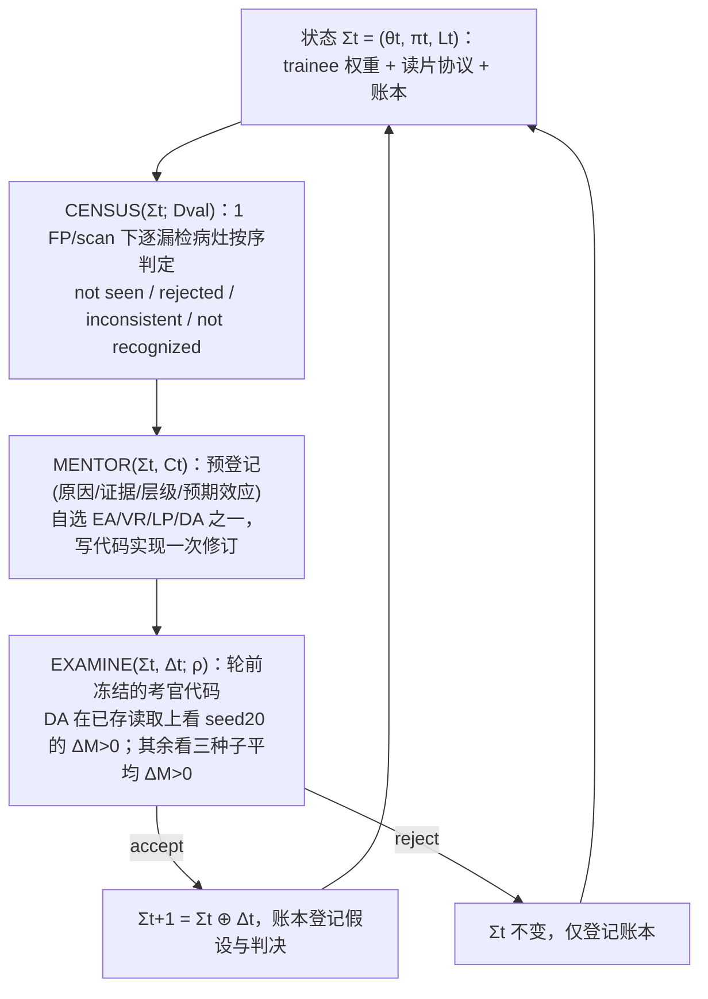

# Can Its Own Misses Teach an MLLM to Find Small Brain Metastases?

> Yixuan Duan, Kexin Geng, Hanwen Xu, Wei Qiu. *arXiv:2611.33836v1 (2026-11-25)*
> 本笔记由引擎自动深读生成（glm-5.3, pipeline deep_read v1），底稿：全文文本

## 1. 背景与动机

临床驱动很直接：约五分之一的癌症患者会发生脑转移，立体定向放射外科可在不做全脑照射的情况下治疗多达十个病灶，因此每个病灶必须先在对比增强 T1 加权（T1c）MRI 上被定位才能被计划——“未找到即未治疗” [p.1](https://arxiv.org/pdf/2611.33836v1#page=1)。专用检测器的敏感性也随尺寸骤降：面向放射外科的检测器对 ≥6 mm 病灶达 98%、总体仅 81%，近年系统对 <3 mm 仍不敏感 [p.1](https://arxiv.org/pdf/2611.33836v1#page=1)。

论文把 MLLM 定位为“通用医学图像阅读器”，其短板恰是放射学最依赖的技能——说清小病灶在哪里 [p.1](https://arxiv.org/pdf/2611.33836v1#page=1)。量化差距有两个锚点：其一，384 px 渲染下 0.1 mL 病灶覆盖不足四分之一个视觉 token [p.1](https://arxiv.org/pdf/2611.33836v1#page=1)——分辨率-token 预算的硬约束，与视频领域小目标经 token 化后信息湮灭的问题同构；其二，1 FP/scan 预算下前沿 MLLM 对 0.1–1 mL 病灶检出不足 30% [p.1](https://arxiv.org/pdf/2611.33836v1#page=1)。逐层同协议读取下的基线：Gemini 3.7 Flash M=.460、Claude Opus 5.5 .409、GPT-6.1 Sol .250、Qwen3.8-27B .250、Gemma 4 31B .231；医学化的 MedGemma 27B 仅 .002 [p.1](https://arxiv.org/pdf/2611.33836v1#page=1)。

常规补救（目标数据上微调）只部分迁移：4B MLLM 经 SFT 后在 BraTS-MET 自留测试集 M=.747，换机构降至 .641 [p.1](https://arxiv.org/pdf/2611.33836v1#page=1)。继续改进通常是“被单一分数牵引的慢速试错”：分数只说变化有没有帮助，不说明模型在哪失败——“层间被跳过的病灶、被展示但未被识别的病灶、排序低于 FP 预算的病灶同等地拉低 M，但各自需要不同修法” [p.1](https://arxiv.org/pdf/2611.33836v1#page=1)。这个三分漏检的观察正是全文方法论支点。

递归自改进还面临三个结构性障碍 [p.2](https://arxiv.org/pdf/2611.33836v1#page=2)：**误差归因**（常规评测只给总分，不给逐病灶原因）；**耦合修订**（给模型看什么、什么分辨率、如何训练、逐层答案如何聚合成逐扫描报告四者相互作用——更薄层显示更多病灶但假阳性也更多，更大渲染只在重训后有用，故修订必须“自由到能改任何一层，又小到可归因”）；**可信继承**（每轮接受的改动被后续所有轮继承，而验证集小、单是重训就能移动单种子分数数个点、见过测试数据或自改接受规则的 agent 会产生不存在的增益）。

## 2. 方法总览

LANTERN 把模型开发重构为误差驱动的闭环，优化对象不是 agent 或其输出，而是一个独立的 MLLM（trainee）及其读片协议 [p.2](https://arxiv.org/pdf/2611.33836v1#page=2)。

**任务与度量** [p.4](https://arxiv.org/pdf/2611.33836v1#page=4)：输入 T1c 体积，输出排序的 3D 点列表。病灶定义为参考分割中增强+非增强标签的 26 连通域（不含瘤周水肿），体积 ≥0.1 mL；报告点落在病灶 mask 5 mm 内记为命中（credited for finding, not delineating）；距 <0.1 mL 病灶 5 mm 内的点既非命中也非 FP，其余非命中点均为 FP。评测沿用 LUNA16 的 FROC 惯例：M = 四个预算 {0.25, 0.5, 1, 2} FP/scan 下召回的均值 [p.4](https://arxiv.org/pdf/2611.33836v1#page=4)。

**优化对象与硬约束** [p.4](https://arxiv.org/pdf/2611.33836v1#page=4)：检测器是“协议包裹的 MLLM”π∘fθ；π 决定给 fθ 看哪些视图、如何渲染、每视图抽取多少答案、答案如何提升到 3D 并合并排序。两条约束保证增益来自 MLLM 本身：f 的模型类固定（θ 可被任意训练改变，但不许换成或级联任务专用检测网络）；最终报告的每个点都必须由 fθ 产生（π 只能选择/合并/排序，不能自造候选）[p.4](https://arxiv.org/pdf/2611.33836v1#page=4)。

**轮次结构** [p.4](https://arxiv.org/pdf/2611.33836v1#page=4)：状态 Σt=(θt, πt, Lt)（权重、协议、账本）。一轮 = CENSUS(Σt; Dval) → MENTOR(Σt, Ct) 产出一次修订 Δt（级别 ℓ∈{EA,VR,LP,DA}）→ EXAMINE(Σt, Δt; ρ)；接受则 Σt+1=Σt⊕Δt 并登记账本，拒绝则仅登记 [p.4](https://arxiv.org/pdf/2611.33836v1#page=4)。接受规则 ρ、评测代码、数据划分在轮 1 之前冻结，循环不能更改。每轮从上一个被接受系统与全部既往认知（含被拒修订的教训）出发——这是递归之所在 [p.4](https://arxiv.org/pdf/2611.33836v1#page=4)。停止条件：15 轮或连续 4 次拒绝 [p.4](https://arxiv.org/pdf/2611.33836v1#page=4)。

**角色** [p.4-5]：trainee 为 Qwen3-VL-4B-Instruct；mentor 为 LLM 编码 agent（Claude Opus 5.5，权重全程不变）；examiner 是固定代码而非 LLM。无人选择、编辑或挽救任何修订 [p.5](https://arxiv.org/pdf/2611.33836v1#page=5)。

**起点 r0** [p.5](https://arxiv.org/pdf/2611.33836v1#page=5)：轴向逐层读取；强度裁剪至非零体素 0.5–99.5 百分位后归一化；切片裁到脑边界框+5 mm、放射学方向、长边 L px；survey 以固定间距 s（mm）过脑。每视图给固定 prompt（命名序列与层位 z 及序号），要求以 0–1000 归一化坐标输出 JSON 点列。SFT 数据：每个 5 mm survey 层及其平移 1–4 层的副本各成一条样本，目标是层内所有 ≥3 体素病灶截面的质心；LoRA（rank 16、α=32、dropout 0.05）加在语言模型全部 attention 与 MLP 投影，视觉编码器冻结，2 epochs、lr 2×10⁻⁴、batch 4 [p.5, p.13]。聚合：点在合并半径 r 内连通成簇，候选位于 medoid（真实报告点而非平均），按 support（报告它的不同层数）排序。r0 = 5 mm survey、L=384、每视图一次贪心读、r=12 mm，三种子 20/21/22 [p.5](https://arxiv.org/pdf/2611.33836v1#page=5)。

一轮的实例（r3）[p.4](https://arxiv.org/pdf/2611.33836v1#page=4)：r3 前验证集 396 个病灶漏 110 个，其中 94 个“看到但没认出”、多为小病灶；mentor 因“0.1–0.3 mL 病灶覆盖不足四分之一视觉 token”而把渲染从 384 提到 768 px 并重训，ΔM=+.050 接受；后续 r7 的 1152 px 被拒（−.012）。

## 3. 关键设计

### 3.1 故障普查：从“漏了 N 个”到“为何漏” [p.5-6]

在验证集、1 FP/scan 预算下，对种子 s 漏掉的每个病灶按序判定四个条件，取第一个成立者：(1) **not seen**：无 survey 层与病灶相交——根本没给模型看；(2) **rejected**：种子 s 有匹配候选但排序低于预算阈值——找到了但聚合丢弃；(3) **inconsistent**：种子 s 无匹配候选，但同配方训练/读取的兄弟种子 s′ 有——配方可识别但不可靠；(4) **not recognized**：其余——展示给模型了，该配方没有任何 trainee 报告它。每漏检恰好归一个原因，四计数之和等于预算下漏检数 [p.5](https://arxiv.org/pdf/2611.33836v1#page=5)；按病灶尺寸（0.1–0.3 / 0.3–1 / 1–5 / >5 mL）分层报告 [p.6](https://arxiv.org/pdf/2611.33836v1#page=6)。工程要点：用兄弟种子做“可识别性”对照，把训练随机性从识别能力中剥离——该设计对任何多 seed 训练的检测/检索系统可直接移植。mentor 还可自写新诊断，整个运行中写了 7 次 [p.6](https://arxiv.org/pdf/2611.33836v1#page=6)。

### 3.2 四级修订空间 [p.6](https://arxiv.org/pdf/2611.33836v1#page=6)

| 层级 | 修订对象 | 目标失败原因（Tab. S1 [p.13](https://arxiv.org/pdf/2611.33836v1#page=13)） |
|---|---|---|
| EA 证据获取 | 层间距、序列、平面、每视图读取数 | not seen、not recognized |
| VR 视觉表示 | 渲染分辨率、输入编码（如邻层作色彩通道）；新输入所需重训属同一修订 | not recognized |
| LP 学习策略 | 训练数据、损失、奖励 | not recognized、inconsistent |
| DA 决策聚合 | 合并半径、候选打分、多次读取合并；可在已存读取上测、零 GPU | inconsistent、rejected |

关键在于修订是**新代码**而非预定义搜索空间中的点——终态系统的 GRPO 训练器、两级聚合与病灶形状分数在运行开始时都不存在，均由 mentor 轮内写出 [p.2, p.6]。每轮 mentor 先向账本写入失败解释、假设、层级、预期效应与判定方式，然后才写代码、提交作业 [p.4, p.6]；普查把 mentor 指向“哪一层可能有用”，但不规定修订内容 [p.6](https://arxiv.org/pdf/2611.33836v1#page=6)。

### 3.3 冻结验证与审计 [p.6](https://arxiv.org/pdf/2611.33836v1#page=6)

接受规则（Eq. 7）：候选与**同种子**的已接受系统比较验证 M 增量 ΔMs；DA 修订只重排已存读取、效果对给定读取是确定性的，只看种子 20 的 ΔM20>0；涉及重训或新视图读取的修订看三种子平均 ΔM>0——理由是“单是重训就能把单个种子移动数个点” [p.2, p.6]。其余种子照打分记录但不裁决。每个修订无论接受与否都计入轮数，被拒结果不得换种子重跑，作业仅可在基础设施故障后重跑且必须记录 [p.6](https://arxiv.org/pdf/2611.33836v1#page=6)。

沙箱与审计：mentor 工作副本只含训练+验证集（测试集与外部队列物理不在场）；无 GPU、无集群直连——作业文件由网关提交（每作业 ≤24 h、128 GB、1 GPU）；评测核心（点-病灶匹配、FP 计数、操作曲线、Eq. 1）运行开始时哈希固化，mentor 可写新评测工具但不得改核心 [p.6](https://arxiv.org/pdf/2611.33836v1#page=6)。事后对全部 373 次工具调用的审计确认评测核心 AST-identical 未变、每个作业只读训练/验证数据、新聚合分数只用 T1c 图像不用标签 [p.6, p.13]。人类只在轮 1 前固定规则/划分/评测，轮中只能修基础设施故障并写独立日志 [p.6](https://arxiv.org/pdf/2611.33836v1#page=6)；测试与外部数据只在冻结后评分一次、从不参与任何决策 [p.6](https://arxiv.org/pdf/2611.33836v1#page=6)。

### 3.4 终态系统 r15 [p.6-7]

- **EA/VR**：2 mm survey（原 5 mm）、L=768 px（原 384），SFT 数据在该尺寸重建并重训 [p.6](https://arxiv.org/pdf/2611.33836v1#page=6)。
- **LP**：SFT 之上 GRPO 600 步；每步抽 16 个训练视图（半数含病灶）、每视图温度 1 采样 G=4 份报告；奖励 Ri=Nhit−λNFP（λ=1，命中/FP 定义与评测一致，不可解析输出 Ri=−1）；优势为 Ri 减组均值；损失为优势加权平均 token 对数似然、无 KL 项、lr 10⁻⁵ [p.6-7, p.13]。
- **DA**：每视图 1 次贪心读 + 4 次温度 1 采样读。贪心候选按 r=6 mm 合并，打分 Eq. 9：score(c)=support(c)+0.9·β(c)/(β(c)+0.05)，β(c) 为候选 3 mm 内 T1c 体积的最大 3D Hessian blobness——同等 support 下圆形高亮结节排在管状血管之上 [p.7](https://arxiv.org/pdf/2611.33836v1#page=7)；blobness 在 2 mm 尺度取值，仅当三个 Hessian 特征值全负时非零，并乘以最小/最大特征值幅值之比 [p.13](https://arxiv.org/pdf/2611.33836v1#page=13)。仅采样读发现、距一切贪心候选 >6 mm 的候选以同一尺度加入，每个 报告计 1/G=0.25 个贪心层报告 [p.7](https://arxiv.org/pdf/2611.33836v1#page=7)。

## 4. 实验结果

**设置** [p.7](https://arxiv.org/pdf/2611.33836v1#page=7)：BraTS-MET 2024 按患者 60/20/20 划分，393/130/129 例；验证与测试集各含 396 个 ≥0.1 mL 病灶；mentor 只见训练+验证。BrainMetShare（异机构异扫描仪）105 例 314 病灶，指纹校验与 BraTS-MET 无重叠。BraTS-MEN-RT 为未见过的脑膜瘤，500 例 615 病灶，SynthStrip 去颅骨，零样本读取不重训。所有基线与 r0 完全同协议（5 mm survey、384 px、同 prompt、每视图一读），同一代码聚合评分 [p.7](https://arxiv.org/pdf/2611.33836v1#page=7)。

主表关键行（Tab. 1 [p.3](https://arxiv.org/pdf/2611.33836v1#page=3)；LANTERN 为三种子均值；R@1 = 1 FP/scan 召回，Small = 1 FP/scan 下 0.1–1 mL 召回）：

| 模型 | 测试 M | 测试 R@1 | 测试 Small | BMS M | MEN-RT M | MEN-RT R@1 |
|---|---|---|---|---|---|---|
| MedGemma 27B | .002 | .000 | .000 | .003 | .007 | .010 |
| Qwen3-VL-4B zero-shot | .107 | .116 | .004 | .058 | .229 | .231 |
| GPT-6.1 Sol | .250 | .303 | .065 | .157 | .383 | .444 |
| Claude Opus 5.5 | .409 | .513 | .292 | .290 | .480 | .470 |
| Gemini 3.7 Flash | .460 | .510 | .285 | .342 | .521 | .580 |
| LANTERN r0 | .747 | .747 | .629 | .641 | .607 | .646 |
| LANTERN r15 | .921 | .937 | .908 | .865 | .740 | .769 |

- **递归自改进让 4B 远超前沿**：r15 测试 M=.921（种子 .929/.920/.914），每种子较 r0 约 +.17 [p.8](https://arxiv.org/pdf/2611.33836v1#page=8)。最强前沿 Gemini .460：FP 不限时可找 88% 病灶但需 4.2 FP/scan [p.8](https://arxiv.org/pdf/2611.33836v1#page=8)。同一 Claude Opus 5.5 作为读片者 M=.409、作为 mentor 把 4B trainee 提到 .921 [p.8](https://arxiv.org/pdf/2611.33836v1#page=8)。MedGemma 27B 近零（.002、61 FP/scan）[p.8](https://arxiv.org/pdf/2611.33836v1#page=8)。
- **增益在小病灶最大**：1 FP/scan 下 r15 找到 90.8% 的 0.1–1 mL 病灶（r0 62.9%、Claude 29.2%）[p.8](https://arxiv.org/pdf/2611.33836v1#page=8)；低于主阈值、从未作为训练目标的 0.05–0.1 mL 病灶（115 个）recall 从 .151 升至 .638 [p.8](https://arxiv.org/pdf/2611.33836v1#page=8)。
- **定位更精细**（Tab. 2 [p.7](https://arxiv.org/pdf/2611.33836v1#page=7)）：命中点距质心中位 1.2 mm（<1 mL 病灶 0.99 mm）；D50（50% 检出概率的直径）4.9 mm（r0 7.1、Gemini 9.7）；≥10 病灶扫描召回 .908（r0 .633、前沿至多 .325）；低对比四分位 .875；小脑病灶 .959、少水肿病灶 .882，前沿至多 .377/.275 [p.7-8]。
- **跨机构与跨类型**：BMS .865（r0 .641，逐种子增益 .19–.25）；MEN-RT 零样本 .740（r0 .607；前沿至多 .521）[p.8](https://arxiv.org/pdf/2611.33836v1#page=8)。
- **逐轮累积且每步在留出数据成立**：15 轮 8 接受 7 拒绝；验证 M 三种子 .664/.694/.667 → .889/.878/.865 [p.8](https://arxiv.org/pdf/2611.33836v1#page=8)；冻结后回溯评分，被接受系统的测试 M 依次 .747→.779→.802→.842→.869→.876→.906→.920→.921，单调上升 [p.8](https://arxiv.org/pdf/2611.33836v1#page=8)；最大单步 +.050（r3），四层轮番贡献 [p.8](https://arxiv.org/pdf/2611.33836v1#page=8)。
- **漏检结构同步迁移**：测试集 1 FP/scan 漏检 100.3→25.0（三种子均值），not recognized 82.0→18.0、inconsistent 18.3→4.7、not seen 两端为 0、rejected 0→2.3（r15 提案多到少量真病灶落到预算之下）；BMS 同向（112.7→36.0；not recognized 91.0→21.0）[p.8](https://arxiv.org/pdf/2611.33836v1#page=8)。
- **定性与统计**：一个含 14 个小转移灶的测试扫描上 r15 找到 14/14，r0 5/14、Claude 3/14、Gemini 1/14 [p.17](https://arxiv.org/pdf/2611.33836v1#page=17)；逐种子配对患者级 bootstrap（2000 重采样）ΔM 的 95% 区间全正、P=1.00 [p.15](https://arxiv.org/pdf/2611.33836v1#page=15)。
- **成本**：整轮 35 h 墙钟、72.8 GPU 小时；373 次工具调用、217 次 mentor 模型调用、0.2M 输出 token；15 轮中 7 轮纯 CPU（重聚合已存读取）[p.8, p.13]。推理侧：r15 每扫描 76 视图×5 读，4B 本地模型半张 H100 NVL 上 25 s；API 基线 29 视图×1 读按列表价（Claude $0.15、Gemini $0.08、GPT-6.1 $0.06 每扫描）[p.15](https://arxiv.org/pdf/2611.33836v1#page=15)。

## 5. 消融要点

**留一消融**（Tab. 3 [p.8](https://arxiv.org/pdf/2611.33836v1#page=8)；M 三种子均值，每行从 r15 移除一个修订）：

| 移除的修订 | 接受时验证 ΔM | 验证 | 测试 | 外部 |
|---|---|---|---|---|
| 无（r15） | — | .877 | .921 | .865 |
| r1 EA：2→5 mm survey | +.028 | .808 | .868 | .781 |
| r3 VR：768→384 px† | +.050 | .758 | .826 | .756 |
| r8 LP：GRPO→仅 SFT | +.018 | .863 | .905 | .834 |
| r12 DA：合并 6→12 mm | +.031 | .844 | .891 | .828 |
| r14 DA：blobness→峰值强度(r2) | +.015 | .863 | .906 | .836 |
| r5 DA：去采样读 | +.044 | .871 | .918 | .862 |
| r15 DA：去单一证据尺度 | +.002 | .876 | .920 | .864 |

† 该行在 greedy SFT reads 口径下测得（768 px 同口径为 .798/.867/.795）[p.8](https://arxiv.org/pdf/2611.33836v1#page=8)。终态 7 项接受修订无一冗余；薄层在留出数据上最重要（测试 −.053、外部 −.084）[p.8](https://arxiv.org/pdf/2611.33836v1#page=8)。

**账本驱动的可解释链条**（r12）[p.8](https://arxiv.org/pdf/2611.33836v1#page=8)：r8 普查把最大份额漏检归入 not recognized；mentor 自写诊断发现 2 FP/scan 下 50 个漏检中 19 个在贪心读 5 mm 内已有点——“小病灶的报告链入邻近簇，簇 medoid 遂距病灶 >5 mm”；先验假设（运行前写入）：“6 mm 合并半径，先验选定、无扫描调参”，使簇相对 5 mm 命中容差保持紧凑；判决 ΔM=+.031（决定种子、三种子皆正），事后移除代价测试 −.030。

**冻结规则的真实约束**：考官拒绝了 1152 px、更长 GRPO 与 2.5D RGB 输入——每项都是“刚帮助过的改动的加码” [p.8](https://arxiv.org/pdf/2611.33836v1#page=8)。完整 15 轮（Tab. S2 [p.13](https://arxiv.org/pdf/2611.33836v1#page=13)）中接受 ΔM 范围 +.0019～+.0495、拒绝 −.0006～−.0164；验证增益 .20 迁移至测试 .17、外部 .22 [p.8](https://arxiv.org/pdf/2611.33836v1#page=8)。

**误差归因是否必要**：S13 把 mentor 降级为只见分数（无普查、验证标签移出工作区、其余不变），原文报告“从同一 r0 出发，LANTERN 用 8 轮而非 15 轮达到了 score-only 系统最终达到的验证 M”——即归因信息把达到同等验证水平所需轮数约减半 [p.16](https://arxiv.org/pdf/2611.33836v1#page=16)。

## 6. 贡献与启示

三点贡献 [p.3](https://arxiv.org/pdf/2611.33836v1#page=3)：(1) 全无人值守的 MLLM 递归自改进环，漏检按原因分类决定每轮修哪一层，mentor 以代码形式写每个修订；(2) census × 四层修订空间 × 冻结审计验证的耦合，每个被接受增益可追溯至一次修订与预登记假设并在留出数据确认；(3) 15 轮评估：M .747→.921、1 FP/scan 下 0.1–1 mL 病灶 91%，外部与未见类型保持，超过同协议前沿 MLLM。

**方法学启示（按本领域口径）**：
- 分数导向自动改进的缺陷在信息量而非自动化程度——census 提供“可行动的失败表示”，每层与可移除该失败的原因对齐 [p.6, p.13]。该设计可移植到任何有明确流水线阶段划分的感知任务。
- 可信自改进的最小机制组合：预登记、冻结裁决、多种子去噪（区分重训噪声与真实增益 [p.2, p.6]）、沙箱隔离、全调用审计（373 次调用 AST-identical 校验 [p.6, p.13]）。机制成本低（7/15 轮零 GPU [p.13](https://arxiv.org/pdf/2611.33836v1#page=13)）却把“agent 自证”与“外部可证”分开——这对一切用验证集做选择的自动流程都是直接可抄的模板。
- mentor 未被告知却收敛到放射学实践：薄层（5→2 mm，符合脑转移薄层 3D 增强 T1 共识）、放大视野（384→768 px）、紧凑病灶先验（blobness 偏好结节状强化灶而非管状血管）[p.8, p.13]——领域先验可从误差归因中自发涌现而非硬编码。

**对音视频技术的上下游含义**：问题结构与视频理解高度同构。(i) 阅读协议 π 是与模型解耦的“采样-渲染-聚合”层：层间距 s ≈ 帧采样率、L ≈ 渲染分辨率、survey+合并 ≈ 时序候选生成与融合；"0.1 mL 病灶 < 1/4 视觉 token”的分辨率-预算权衡即视频小目标 token 化信息湮灭问题，r3（768 px，+.0495）与 r1（2 mm，+.028）给出“先提分辨率还是先提采样密度”的实证排序参照 [p.4, p.8]。(ii) 四原因分类可映射到时序定位的失败分析：not seen≈帧采样间隙漏事件、not recognized≈单帧识别失败、inconsistent≈种子敏感性、rejected≈时序聚合/NMS/排序吞掉候选；对时序动作检测、视频 Grounding、镜头切分，census 式归因同样能把单一 mAP/Recall 拆成可行动的四类。(iii) DA 层的“贪心+温度采样、support 计数 + 外观先验分（blobness≈时域一致性/显著性先验）”两级证据融合，是纯 LLM 检测器做时序聚合的低成本模板，且 DA 修订在已存读取上零 GPU 验证 [p.6-7, p.13]。(iv) 4B 本地推理（25 s/扫描 [p.15](https://arxiv.org/pdf/2611.33836v1#page=15)）对照 API 按视图计费的经济学，对视图数随帧率线性膨胀的视频尤其尖锐——EA 层每次“加密采样”都直接乘到推理成本上。

**局限**：病灶类型与模态单一（作者自述未来扩展其他病灶/模态并允许修订视觉编码器 [p.8](https://arxiv.org/pdf/2611.33836v1#page=8)）；trainee 固定为 4B Qwen3-VL、mentor 固定为 Claude Opus 5.5，未检验换 mentor 的敏感性；5 mm 命中容差度量“发现”而非“勾画” [p.4](https://arxiv.org/pdf/2611.33836v1#page=4)；0.05–0.1 mL（.638）与 MEN-RT（.740）仍留明显空间 [p.3, p.8]；census 依赖参考分割标签，只能运转于有标注的验证集 [p.5](https://arxiv.org/pdf/2611.33836v1#page=5)。

## 7. 与其他论文的联系

- **MedicalRSI（arXiv:2611.26806）**：同为医学 LLM 智能体递归自改进且都在“模型-框架协同进化”——LANTERN 的 Σt=(θ, π) 联合优化与 MedicalRSI 的 Solver/Improver 模型-框架共演进同构；差异在 LANTERN 改进的是独立 trainee MLLM 而非 agent 自身，且以误差归因而非响应反馈导向修订 [p.2](https://arxiv.org/pdf/2611.33836v1#page=2)。
- **EVA-RSI（arXiv:2611.23890）**：同为 RSI 框架且都处理感知质量判断——EVA-RSI 面向视频评估器的运动/时序质量，LANTERN 面向医学影像定位；两者都以“冻结的外部裁决”防自评泄漏（EVA-RSI 用代理考试+纳什议价，LANTERN 用轮前冻结的代码考官+哈希评测核心+审计 [p.6](https://arxiv.org/pdf/2611.33836v1#page=6)）。对想在视频侧复用 LANTERN 思路者，EVA-RSI 是最近的同范式参照。
- **RecurSciBench（arXiv:2611.32508）**：该基准度量 RSI 的跨任务/跨域迁移收益；LANTERN 的外部队列（.865）与未见类型（.740）测试 [p.8](https://arxiv.org/pdf/2611.33836v1#page=8) 正是其单任务内的迁移证据，但 LANTERN 未做跨任务评估。
- **TrainExplorer（arXiv:2611.20430）**：自主 LLM 后训练的“规划-执行解耦”与 LANTERN mentor 的执行解耦（无 GPU、作业文件经网关提交 [p.6](https://arxiv.org/pdf/2611.33836v1#page=6)）同构；差异在被训对象与训练策略本身由 mentor 轮内写出（SFT→GRPO）[p.6-7]。
- **TRUST（arXiv:2611.10787）**：为 RSI 提供在线多重假设检验式统计保证；LANTERN 的接受规则是确定性阈值（ΔM>0）加三种子均值 [p.6](https://arxiv.org/pdf/2611.33836v1#page=6)，事后配对 bootstrap 不进入裁决 [p.6, p.15]——TRUST 式错误率控制是其自然强化层，尤其当轮数与修订数增大时。
- **SkillDuet（arXiv:2611.12109）**：以响应反馈协同模型参数与外部技能库演化，对应 LANTERN 的"θ+π+账本"三件套；但 LANTERN 的账本是假设-判决记录（含被拒修订的知识 [p.4](https://arxiv.org/pdf/2611.33836v1#page=4)）而非可复用技能库，修订以四层代码而非技能形式沉淀 [p.6](https://arxiv.org/pdf/2611.33836v1#page=6)。

[原文 PDF](https://arxiv.org/pdf/2611.33836v1) · 19 页 · SHA-256 `f715d67130966b0dc79d77983a8a6634d7c27dc8a367b948853c993a0416fed4`
